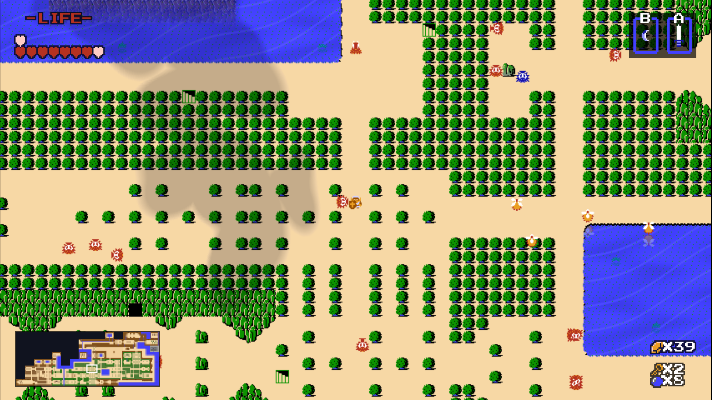

# Zelda Wide

[](https://github.com/Pedro-HenriqueFF/zelda-wide/actions/workflows/ci.yml)

A from-scratch NES emulator (6502, MMC1, PPU) with an SDL2 front-end, built to play *The Legend of Zelda* with a **widescreen overworld**,
**fog of war** and a lot of extra polish, because owning the renderer makes it possible. The game itself runs unmodified underneath.



> **You must supply your own ROM.** No game data is included or needed to build. Target ROM: `Legend of Zelda, The (U) (PRG0) [!].nes`.
> This is an unofficial fan project, not affiliated with or endorsed by Nintendo.

Current version: **milestone 100**. Playable start to finish except for sound (not implemented).

## What it does

- **Widescreen overworld** decoded straight from the ROM around the game's own picture, with a Link-centred camera, zoom and a glide between screens.
- **Fog of war** and a minimap: unexplored screens fade into the fog, hidden secrets of explored screens are hinted at.
- **Neighbour screens running** (experimental, `N`): monsters, fairies and items of the screens next to Link keep moving in the margins.
- **Atmosphere:** day/night cycle with dynamic light, cloud shadows, water reflections and waves, torches and water in dungeons, mist in the Lost Woods.
- **Quality of life:** transparent corner HUD, caves and the inventory in framed boxes, sword and sprites completed at the screen borders,
  smooth dungeon scrolling, no sprite flicker or slowdown in crowded rooms (the NES behaviour is one key away), saving with `F10`.
- The per-pixel effects run on several threads; the author's Windows PC holds about 60 fps even at the highest zoom.

Not implemented: audio, and widescreen caves/dungeons (they use the big centred picture). Every feature in detail: **[FEATURES.md](FEATURES.md)**.

## Quick start

You need a C++17 compiler, CMake and SDL2 (CMake downloads SDL2 itself if it is not installed).

```
# Linux / WSL
sudo apt install build-essential cmake libsdl2-dev
cmake -B build && cmake --build build -j
./build/zelda_wide /path/to/zelda.nes
```

On Windows run `powershell -ExecutionPolicy Bypass -File tools\win-build.ps1`, then `build\Release\zelda_wide.exe path\to\zelda.nes`.
All the details (Visual Studio, MinGW, incremental updates, AVX2, prebuilt SDL2): **[docs/BUILDING.md](docs/BUILDING.md)**.

The game saves next to the ROM as `<romname>.sav` (and `<romname>.fog` for the explored map).

## Controls

| NES | Keyboard |
|-----|----------|
| D-pad | Arrow keys or WASD |
| A / B | X / Z |
| Start / Select | Enter / Tab (or Right Shift, Backspace) |

Game controllers work too (south button = B, east button = A).

| Key | Function |
|-----|----------|
| `F1` | day/night cycle and lights |
| `F2` | fog of war (off = reveal the map) |
| `F3` | widescreen on/off |
| `F4` / `+` / `-` | zoom |
| `F5` | reset the game |
| `F6` | big/small caves and dungeons |
| `F7` | HUD overlay on/off |
| `F8` | minimap style |
| `F9` | caves in a box |
| `F10` | save the game (also SELECT in the inventory) |
| `F11` | fullscreen |
| `F12` | cloud shadows |
| `End` / `Page Down` | water reflections / water waves |
| `N` | neighbour screens running (experimental) |
| `Insert` | the NES's own sprite limits and slowdown on/off |
| `` ` `` | fast-forward while held |

More keys (debug dumps with `Home` and `Page Up`) and the command line options (`--no-wide`, `--no-fog`, `--trace`, `--perf`) are in [FEATURES.md](FEATURES.md).

## Tests

No ROM or SDL needed: the tests run on a synthetic ROM.

```
cmake -B build && cmake --build build -j
ctest --test-dir build --output-on-failure
```

On Windows `tools\win-test.ps1` runs them and names the crashing section if there is one. `tools/check.sh` (Linux/WSL) is the fast development loop
(incremental build, all tests, sanitizer mode with `--san`); `tools/linux-update.sh` and `tools\win-update.ps1` update the folder from a new zip without rebuilding everything.

## Project layout

```
src/        emulator core (cpu, ppu, cart, nes) and the widescreen compositor (widescreen*.cpp), SDL front-end in main.cpp
tests/      headless tests (core, overworld decoder, compositor on a synthetic ROM)
tools/      check.sh (build + tests), Windows build helpers, small utilities
docs/       BUILDING.md, ARCHITECTURE.md
```

A file-by-file map is in [docs/ARCHITECTURE.md](docs/ARCHITECTURE.md). Contributions are welcome: see [CONTRIBUTING.md](CONTRIBUTING.md).

## How this was made

This project was written with **Claude** (Anthropic's AI assistant), in conversation, on the **free plan**, using mostly **Claude Sonnet 5.5** on High/Medium
effort. The author directed the work, tested every change on the real game and reported what looked or behaved wrong; Claude wrote the code, the tests and the
documentation. The automated tests in `tests/` check the behaviour, but expect rough edges.

## Acknowledgments

- The research into how the game works relies on the excellent public disassembly
  [aldonunez/zelda1-disassembly](https://github.com/aldonunez/zelda1-disassembly).
- [SDL2](https://www.libsdl.org/) for window, input and rendering.
- *The Legend of Zelda* is a trademark and copyright of Nintendo. This project contains no Nintendo code or data.

## License

[MIT](LICENSE) for the code in this repository. The game itself is not covered and not included.
